## Phase 2 Demo — SiWx917 Dual-Stack Thermostat (Matter + MQTT + HTTPS)

### Description

Build a SiWx917 BRD4338A Wi-Fi Thermostat app to evaluate:

- **Matter thermostat** — BLE commission, control over Wi-Fi
- **Dual stack** — Matter + MQTTS on host LwIP; HTTPS on NWP
- **Live MQTT** — stay connected (idle auto-yield); subscribe/publish via Matter shell; receive inbound publishes
- **HTTPS** — GET / PUT / POST via Matter shell after client init

This demo uses TLS 1.2 for authentication and FreeRTOS Heap3 for memory management.
TLS 1.3 is only supported for the HTTPs client, but not on the MQTTs client.

**Project name:** `matter_wifi_soc_thermostat_dual_stack_freertos`

### Runtime flow (AppTask + Matter shell)

Service demos are owned by the thermostat `AppTask` (not `BaseApplication`):

1. On `kInternetConnectivityChange` (IPv4, or IPv6 when dual-stack is enabled), `AppTask::MatterServicesEventHandler` posts work to the AppTask thread.
2. `mqtt_client_demo_start()` — Start / Init; Connect runs from `OnInitDone`. The MQTT service thread idle-yields for keepalive and inbound messages; the session stays up.
3. `https_client_demo_start()` — Start / Init only (default NWP certificate index; no hardcoded index).
4. On `kWiFiConnectivityChange` with `kConnectivity_Lost`, `mqtt_client_demo_stop()` disconnects MQTT (Start/Init kept for reconnect).
5. Matter shell (`demo mqtt` / `demo http`) posts Subscribe/Publish or HTTPS PUT/GET/POST onto the AppTask thread so blocking work does not starve the CHIP stack.

## Adding Wi-Fi and Matter Extension in Studio

1. Open Simplicity Studio V6 and install SISDK 2026.6 (do not install Matter and Wi-Fi SDK yet).
2. Once installed, open **SDKs** in settings and select **Add Extension**.
   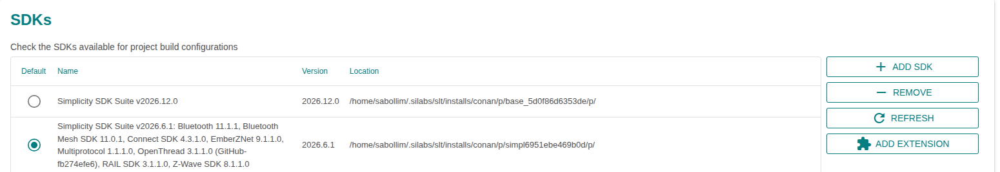
3. Add the Matter and Wi-Fi extensions:
   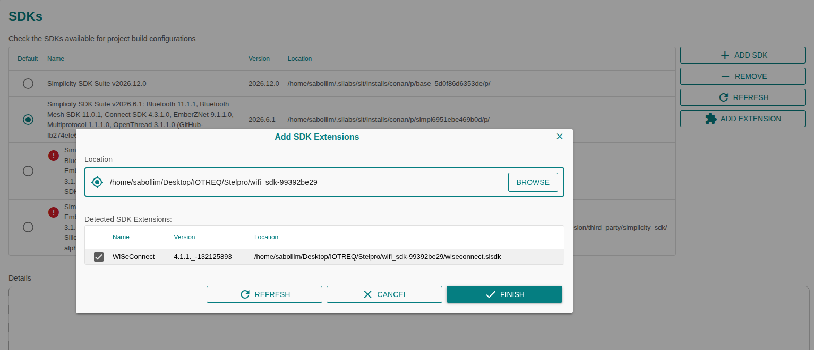
   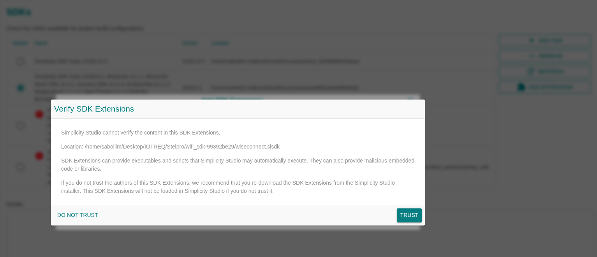
   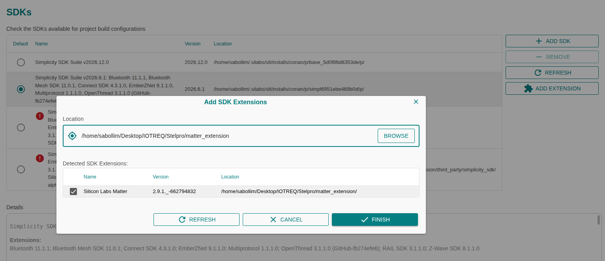
4. Once both extensions are added, the SDK should look like this:
   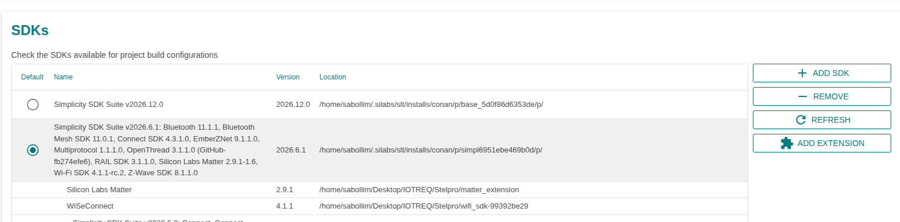
5. Customize the demo in the Matter source. Open the Matter source as shown below:
   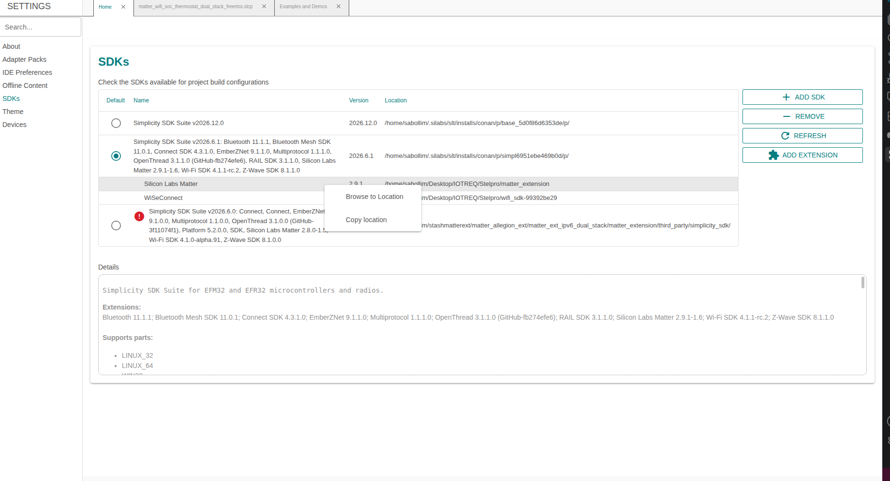
6. Apply the changes below in:

- `third_party/matter_sdk/examples/thermostat/silabs/src/mqtt_example.cpp`
- `third_party/matter_sdk/examples/thermostat/silabs/include/mqtt_example.h`
- `third_party/matter_sdk/examples/thermostat/silabs/include/https_offload_example.h`
- `third_party/matter_sdk/examples/thermostat/silabs/certs/cacert.h`

### Changes for `OnPlatform` events based on the `CHIPDeviceEvent.h`

Event types come from `third_party/matter_sdk/src/include/platform/CHIPDeviceEvent.h` (`DeviceEventType`). The MQTT demo registers `OnPlatformEvent` with `PlatformMgr().AddEventHandler` in `mqtt_example.cpp` (from `mqtt_client_demo_start`, once when the client is not yet initialized).

| Event (`DeviceEventType`)            | Condition / payload                   | Demo log                            |
| ------------------------------------ | ------------------------------------- | ----------------------------------- |
| `kWiFiConnectivityChange`            | `Result == kConnectivity_Established` | `MQTT demo: WiFi Connected`         |
| `kWiFiConnectivityChange`            | `Result == kConnectivity_Lost`        | `MQTT demo: WiFi Disconnected`      |
| `kCommissioningComplete`             | Commissioning finished                | `MQTT demo: Commissioning Complete` |
| `kSLSystemEventCommissioningStarted` | Commissioning started                 | `MQTT demo: Commissioning Started`  |
| `kSLSystemEventCommissioningFailed`  | Commissioning failed                  | `MQTT demo: Commissioning Failed`   |

Example handler (already in the demo source):

```cpp
void OnPlatformEvent(const ChipDeviceEvent * event, intptr_t /* arg */)
{
    VerifyOrReturn(event != nullptr);

    switch (event->Type)
    {
    case DeviceEventType::kWiFiConnectivityChange:
        if (event->WiFiConnectivityChange.Result == kConnectivity_Established)
        {
            ChipLogProgress(DeviceLayer, "MQTT demo: WiFi Connected");
        }
        else if (event->WiFiConnectivityChange.Result == kConnectivity_Lost)
        {
            ChipLogProgress(DeviceLayer, "MQTT demo: WiFi Disconnected");
        }
        break;

    case DeviceEventType::kCommissioningComplete:
        ChipLogProgress(DeviceLayer, "MQTT demo: Commissioning Complete");
        break;

    case DeviceEventType::kSLSystemEventCommissioningStarted:
        ChipLogProgress(DeviceLayer, "MQTT demo: Commissioning Started");
        break;

    case DeviceEventType::kSLSystemEventCommissioningFailed:
        ChipLogProgress(DeviceLayer, "MQTT demo: Commissioning Failed");
        break;

    default:
        break;
    }
}
```

Registration:

```cpp
err = PlatformMgr().AddEventHandler(OnPlatformEvent, 0);
```

These prints are for observing connectivity and commissioning while MQTT/HTTPS run. Starting and stopping the services on IP/Wi-Fi changes is handled separately by `MatterServicesEventHandler` in `AppTask.cpp` (`kInternetConnectivityChange` / `kWiFiConnectivityChange`).

### MQTTS changes (`mqtt_example.h`)

Add these `#define`s near the top of the file (before the `#ifndef` / `#error` checks). Values must match your LAN broker:

| Symbol                 | Description                                                                                                                                                 |
| ---------------------- | ----------------------------------------------------------------------------------------------------------------------------------------------------------- |
| `MQTT_BROKER_ENDPOINT` | DNS name or IPv4 string for MQTTS connect. Literals use `sl_net_inet_addr`; otherwise DNS resolve. Must be reachable from the board.                        |
| `MQTT_TLS_HOSTNAME`    | Hostname for TLS SNI / cert check (CN/SAN). If not provided (`nullptr`), `MqttClient` uses `MQTT_BROKER_ENDPOINT`. Must match the broker cert or TLS fails. |
| `MQTT_BROKER_PORT`     | MQTTS TCP port.                                                                                                                                             |

Optional overrides (defaults exist via `#ifndef`): `MQTT_USERNAME`, `MQTT_PASSWORD`, `MQTT_TOPIC`, `MQTT_PUBLISH_MESSAGE`, `MQTT_CLIENT_ID`, `MQTT_CLIENT_PORT`.

Example (replace with your broker values):

```c
#define MQTT_BROKER_ENDPOINT ""
#define MQTT_TLS_HOSTNAME ""
#define MQTT_BROKER_PORT 8883
#define MQTT_TOPIC "MQTT_TOPIC"
#define MQTT_PUBLISH_MESSAGE "MQTT_PUBLISH_MESSAGE"
```

Inbound publishes are delivered through `MqttClient::SetSubscriptionCallback` (`OnMqttMessage` in `mqtt_example.cpp`). While connected and idle, the MQTT service thread auto-runs `MQTTYield` for keepalive and receive — no explicit Yield from the demo is required after subscribe/publish.

### Certificates (`certs/cacert.h`)

- `kCaCertExample[]` — Trusted CA used to verify the CA cert. Fill with PEM of the CA that signed the cert (same format as the sample: `-----BEGIN CERTIFICATE-----` …). The sample CA will not work with your server.
- If MQTTS and HTTPS use different CAs, use the CA for the demo you are running (or split into two cert files).

### HTTPS changes (`https_offload_example.h`)

Add these `#define`s near the top of the file (before the `#ifndef` / `#error` checks). Values must match your LAN HTTPS server:

| Symbol                 | Description                                                                                                                                                  |
| ---------------------- | ------------------------------------------------------------------------------------------------------------------------------------------------------------ |
| `HTTP_SERVER_ENDPOINT` | DNS name or IPv4 of the HTTPS server. Must be reachable from the board.                                                                                      |
| `HTTP_TLS_HOSTNAME`    | Hostname for TLS SNI / Host header (CN/SAN). If not provided (`nullptr`), `HttpClient` uses `HTTP_SERVER_ENDPOINT`. Must match the server cert or TLS fails. |
| `HTTP_PORT`            | HTTPS TCP port.                                                                                                                                              |

Optional overrides (defaults exist via `#ifndef`): `HTTP_USER`, `HTTP_PASS`, `HTTP_URL`, `HTTP_POST_DATA`.

Example (replace with your server values):

```c
#define HTTP_SERVER_ENDPOINT ""
#define HTTP_TLS_HOSTNAME ""
#define HTTP_PORT 8443
```

The HTTPS demo leaves `HttpClientConfig::certificateIndex` at the default (`SL_HTTPS_CLIENT_DEFAULT_CERTIFICATE_INDEX`, typically `0`). Do not hardcode a non-default index unless your NWP credential layout requires it.

### HTTPS OTA Changes (sl_matter_https_ota_config.h)

Update these defines that match to your HTTPS server:

| Symbol                                 | Description                                                     |
| -------------------------------------- | --------------------------------------------------------------- |
| 'SL_MATTER_HTTPS_OTA_PERIODIC_TIMEOUT' | HTTPS ota downloader's periodic retry timer                     |
| 'SL_MATTER_HTTPS_OTA_DEFAULT_URL'      | Default url for HTTPS ota downloader to use for periodic checks |

Example (replace with your server values)):

```c
#define SL_MATTER_HTTPS_OTA_PERIODIC_TIMEOUT (24 * 60 * 60)
#define SL_MATTER_HTTPS_OTA_DEFAULT_URL "https://otaserver.com:8443/otafile.ota"
```

## Creating Thermostat Demo in Studio

1. Go to **Home**, select **Matter** projects.
   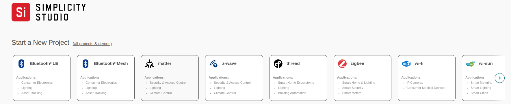
2. Filter projects with the **Dual** keyword and select the thermostat project.
   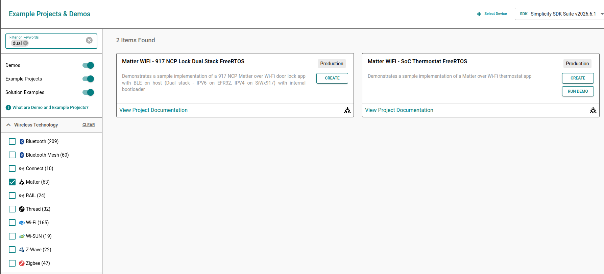
3. Select target device **BRD4338A**.
   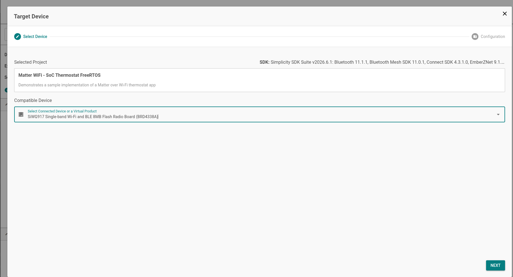
4. Configure the project as below.
   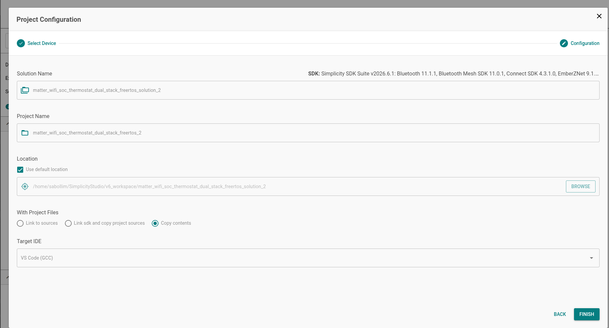
5. Once **Finish** is selected, the project is created.
   
6. Sometimes generation fails during project creation. Force generate if generation fails.
   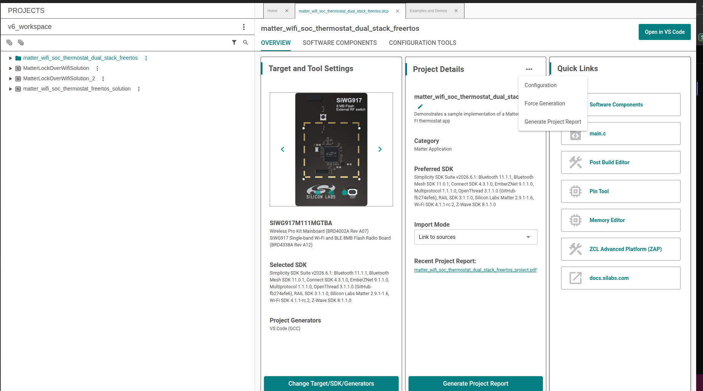
7. Once generation is successful, select **Open in VS Code**.
8. The project opens in VS Code. Select the build icon beside the project name to build.
   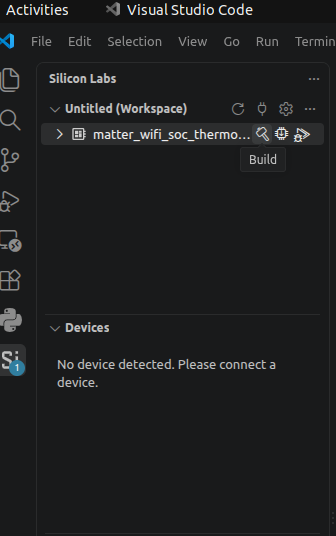
9. Build should complete successfully. You will see logs like below in the VS Code terminal.
   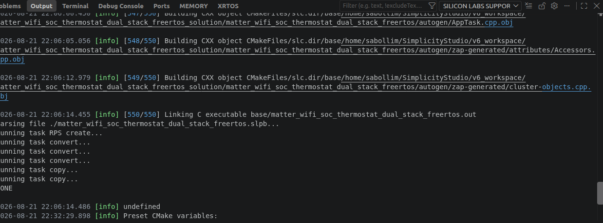
10. If the device is attached to the workstation, select the flash icon beside the project name in Studio, or use Commander to flash the image.
    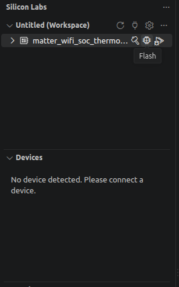

## Changes needed for validating the demo

Edit before build. Point defaults at **your** LAN.

### MQTT — `mqtt_example.h`

| Field           | `#define`                         | Demo default           | Customer need to set                    |
| --------------- | --------------------------------- | ---------------------- | --------------------------------------- |
| Broker endpoint | `MQTT_BROKER_ENDPOINT`            | ``                     | MQTTS DNS name or IPv4                  |
| TLS hostname    | `MQTT_TLS_HOSTNAME`               | ``                     | Matches broker cert; else endpoint used |
| Port            | `MQTT_BROKER_PORT`                | ``                     | MQTTS port                              |
| User / pass     | `MQTT_USERNAME` / `MQTT_PASSWORD` | `john` / `doe`         | Broker auth                             |
| Topic           | `MQTT_TOPIC`                      | `MQTT_TOPIC`           | Align with MQTT Explorer                |
| Publish body    | `MQTT_PUBLISH_MESSAGE`            | `MQTT_PUBLISH_MESSAGE` | Payload you expect                      |
| CA              | `kCaCertExample[]` in `cacert.h`  | Broker CA              |                                         |

### HTTPS — `https_offload_example.h`

| Field           | `#define`                        | Demo default   | Customer need to set                    |
| --------------- | -------------------------------- | -------------- | --------------------------------------- |
| Server endpoint | `HTTP_SERVER_ENDPOINT`           | ``             | HTTPS DNS name or IPv4                  |
| TLS hostname    | `HTTP_TLS_HOSTNAME`              | ``             | Matches server cert; else endpoint used |
| Port            | `HTTP_PORT`                      | ``             | HTTPS port                              |
| Auth            | `HTTP_USER` / `HTTP_PASS`        | `john` / `doe` | Auth                                    |
| CA              | `kCaCertExample[]` in `cacert.h` | Server CA      |                                         |

### HTTPS OTA — sl_matter_https_ota_config.h

| Field            | `#define`                              | Demo default                       | Customer need to set                                 |
| ---------------- | -------------------------------------- | ---------------------------------- | ---------------------------------------------------- |
| Periodic Timeout | `SL_MATTER_HTTPS_OTA_PERIODIC_TIMEOUT` | 86400 (Same as Matter OTA timeout) | Peroidic retry timer value                           |
| OTA Default URL  | `SL_MATTER_HTTPS_OTA_DEFAULT_URL`      | ``                                 | HTTPS server IPv4 url to OTA file for periodic retry |

## Software and Hardware Requirements

- SiWx917 kit
- Wi-Fi AP
- Mosquitto
- Local HTTPS server
- `chip-tool` or other commissioning tool
- Serial terminal attached to the device console (Matter shell)

Steps to install Mosquitto and set up a local HTTPS server on a Linux machine.

> **Note:** Broker and HTTPS server must be on the **same LAN** as the board.

## How to Test

### Matter commissioning and basic thermostat commands

After flashing the image on the BRD4338A board, run the following from `chip-tool`:

```bash
# Commission device using chip-tool
chip-tool pairing ble-wifi 1 <SSID> <PSK> 20202021 3840
# Expect successful commissioning in chip-tool log

# Write to device using chip-tool
chip-tool thermostat write occupied-cooling-setpoint 2500 1 1
# Expect success in chip-tool log

# Read from device using chip-tool
chip-tool thermostat read occupied-cooling-setpoint 1 1
# Expect "2500" value as output in chip-tool log
```

### Matter shell (required for MQTT / HTTPS demos)

Open a serial terminal to the device console (Matter shell is enabled for this dual-stack thermostat build). After Wi-Fi / internet is up, wait for service start logs, then run demos from the shell. This shell runs over UART, meanwhile logs are directed to JLink RTT.

Help:

```text
demo
```

Expected help text (when both services are enabled):

```text
Usage: demo <service>
  http  Run HTTPS PUT/GET/POST on the AppTask thread
  mqtt  Run MQTT connect/subscribe/publish on the AppTask thread
```

| Shell command | What runs on AppTask                                       |
| ------------- | ---------------------------------------------------------- |
| `demo mqtt`   | `mqtt_client_demo_run()` — Subscribe + Publish             |
| `demo http`   | `https_client_demo_run()` — HTTPS PUT, then GET, then POST |

Shell replies immediately with a post confirmation; results appear in the device log:

```text
> demo mqtt
Posting MQTT connect/subscribe/publish to AppTask

> demo http
Posting HTTPS PUT/GET/POST to AppTask
```

Do not run these from the shell thread expectation of blocking completion — the shell only queues AppTask work. This is a trigger based operation, shell will say success once the operation is queued. Then the scheduler is responsible for execution of the task, and corresponding output will be shown.

### MQTT

After Wi-Fi is up, wait for connectivity-driven start. Expect logs similar to:

```text
Scheduling Matter Services initialization
MQTT demo: starting service
MQTT demo: initializing client
[MQTT] connecting to broker <broker-endpoint> port 8883 (TLS=yes)
MQTT demo: ready (use demo mqtt for subscribe/publish)
```

Connect runs from the Init completion callback (`OnInitDone`) during `mqtt_client_demo_start()`, not from the shell.

1. Subscribe on the host to your topic (example uses `MQTT_TOPIC`) **before** running `demo mqtt`:

```bash
 mosquitto_sub -h <IP-or-hostname> -p 8883 --cafile ca.crt -t MQTT_TOPIC -v
```

2. On the device Matter shell:

```text
 demo mqtt
```

3. On the host subscriber you should see the configured `MQTT_PUBLISH_MESSAGE` on `MQTT_TOPIC`.
4. Publish from MQTT Explorer (or `mosquitto_pub`) to the same topic. The device should log the inbound message via the subscription callback while the session stays alive (idle auto-yield).

**MQTT demo logs on device (after** `demo mqtt`**):**

```text
[info][DL] MQTT demo: subscribing to topic MQTT_TOPIC
[info][DL] MQTT demo: publishing message to topic MQTT_TOPIC
[info][DL] MQTT demo: completed (auto-yield keeps session alive)
[info][DL] MQTT demo: message on MQTT_TOPIC: <payload from broker>
```

You can run `demo mqtt` again later; if already connected, Connect is skipped and Subscribe/Publish run again.

### HTTPS

After Wi-Fi is up, `https_client_demo_start()` loads the CA at the default certificate index and inits the client. Then run the request sequence from the Matter shell:

```text
demo http
```

Validate with logs similar to:

```text
[info][DL] HTTPS loaded TLS CA at index 0
[info][DL] HTTPS client init success
[info][DL] HTTPS starting on offload stack
[info][DL] HTTPS PUT response: status=0x0 end_of_data=0 data_len=0
[info][DL] HTTPS PUT response: status=0x0 end_of_data=1 data_len=0
[info][DL] HTTPS PUT response: status=0x0 end_of_data=9 data_len=59
[info][DL] HTTPS PUT request success
[info][DL] HTTPS GET response: status=0x0 http_code=200 data_len=1024 end_of_data=...
[info][DL] HTTPS GET request success
[info][DL] HTTPS POST response: status=0x0 http_code=200 data_len=38
[info][DL] HTTPS POST request success
[info][DL] HTTPS demo completed
```

Init (`HTTPS loaded TLS CA…` / `HTTPS client init success`) happens on connectivity; PUT/GET/POST lines appear after `demo http`.

### HTTPS OTA

#### Pre-conditions

1. Generate a multi image ota file with SW version greater than the flashed SW version.
2. Place the ota file in the server path.
3. Start HTTPS server that supports Range requests.
4. Get the url to the file including hostname, port and path. For example: `https://otaserver.com:8443/otafile_v2.0.ota`. Use your hostname, port and path instead of the example.

#### Steps

1. After WiFi is up, wait for the device log: `HTTPS client init success` (~10s after connectivity) for HTTPS client to be initialized.
2. From Matter Shell, send a command of the format `https-ota url <url>`. For example using the url from precondition, the command will be `https-ota url https://otaserver.com:8443/otafile_v2.0.ota`
3. Verify the Matter Shell responds Done.
4. Verify the device log is as below for a successful ota download start:

```text
[0000:04:47.321][info][SWU] [HTTPS-OTA] using passed url=https://192.168.50.145:8443/test_multiota_v1_Office_2.0.ota
[0000:04:47.322][info][SWU] Stopping the Periodic Query timer
[0000:04:47.328][info][SWU] HandlePrepareDownload: started
[0000:04:49.730][info][DL] HTTPS GET response: status=0x0 http_code=206 data_len=1024 end_of_data=1
[0000:04:49.732][info][SWU] [HTTPS-OTA] header accepted: vendor=65521 product=32782 version=2
[0000:04:49.733][error][SWU] Processed header successfully
[0000:04:49.733][info][SWU] Selected processor with tag: 1
[0000:04:49.734][info][SWU] Process WiFi Block
[0000:04:52.103][info][DL] HTTPS GET response: status=0x0 http_code=206 data_len=1024 end_of_data=1
[0000:04:52.104][info][SWU] Process WiFi Block
[0000:04:54.400][info][DL] HTTPS GET response: status=0x0 http_code=206 data_len=1024 end_of_data=1
[0000:04:54.401][info][SWU] Process WiFi Block
[0000:04:56.697][info][DL] HTTPS GET response: status=0x0 http_code=206 data_len=1024 end_of_data=1
[0000:04:56.698][info][SWU] Process WiFi Block
.
.
.

```

5. Once the download finishes, verify the device log is as below:

```text
.
.
.
[0000:37:39.171][info][SWU] Process WiFi Block
[0000:37:41.467][info][DL] HTTPS GET response: status=0x0 http_code=206 data_len=1024 end_of_data=1
[0000:37:41.468][info][SWU] Process WiFi Block
[0000:37:43.764][info][DL] HTTPS GET response: status=0x0 http_code=206 data_len=567 end_of_data=1
[0000:37:43.775][info][SWU] [HTTPS-OTA] RESULT: PASS
[0000:37:43.775][info][SWU] Process WiFi Block
[0000:37:44.072][error][DL] Long dispatch time: 297 ms, for event type 2
[0000:37:44.072][error][SWU] HandleFinalize begin
[0000:37:44.073][info][SWU] Finalize Action

[0000:37:44.073][info][SWU] OTA image downloaded successfully
[0000:37:44.074][info][SWU] HandleApply: started
[0000:37:44.079][info][SWU] HandleApply: Finished and Soft Reset initiated
```

6. Reset the board and verify the device log captures updated SW version.

```text
[0000:00:01.765][info][DL] STARTUP EVENT
[0000:00:01.768][info][SVR] Current Software Version String: 2.0
[0000:00:01.769][info][SVR] Current Software Version: 2
.
.
.
[0000:00:24.376][info][DL] HTTPS client init success
[0000:00:27.352][info][SWU] HTTPS OTA: skipped NotifyUpdateApplied
```

7. The default url for periodic checks can be updated with the command of the format `https-ota default <url>`. For example, `https-ota default https://otaserver.com:8443/otafile_v3.0.ota`. Verify Matter Shell responds Done.

8. OTA download in progress can be aborted by sending command `https-ota abort`. Verify Matter Shell responds Done.

9. If the periodic retry timer triggers the ota download, verify the device log at the download start will be as below and the remaining steps stay the same.

```text
[0000:01:31.356][info][SWU] [HTTPS-OTA] session start source=periodic url=https://otaserver.com:8443/test_multiota_v15_Office_2.0.ota
[0000:01:31.357][info][SWU] Stopping the Periodic Query timer
[0000:01:31.362][info][SWU] HandlePrepareDownload: started
[0000:01:33.733][info][SWU] [HTTPS-OTA] header accepted: vendor=65521 product=32782 version=2
[0000:01:33.734][error][SWU] Processed header successfully
[0000:01:33.735][info][SWU] Selected processor with tag: 1
[0000:01:33.735][info][SWU] Process WiFi Block
```

10. When a Matter OTA download is already in progress when a HTTPS OTA download is requested, verify the HTTPS OTA request fails with the device log as below:

```text
[0000:00:53.299][info][SWU] [HTTPS-OTA] using passed url=https://192.168.50.145:8443/test_multiota_v20_Office_5.0.ota
[0000:00:53.300][error][SWU] [HTTPS-OTA] RESULT: FAIL busy db
[0000:00:53.301][error][SWU] [HTTPS-OTA] StartUpdate failed: db
```

11. When a HTTPS OTA download is already in progress when a Matter OTA announcement arrives, verify that announcement is ignored `[HTTPS-OTA] active: ignoring AnnounceOTAProvider` with the device log as below:

```text
[0000:11:10.637][info][EM] >>> [E:9389r S:0 M:127350818] (U) Msg RX from 0:E78C9541208FD9DB [0000] to 0000000000000000 --- Type 0000:30 (SecureChannel:CASE_Sigma1) (B:196)
[0000:11:10.638][info][IN] CASE Server received Sigma1 message . Starting handshake. EC 0x19a98
[0000:11:10.640][info][EM] <<< [E:9389r S:0 M:236655491 (Ack:127350818)] (U) Msg TX from 0000000000000000 to 0:E78C9541208FD9DB [0000] [UDP:[fe80::e65f:1ff:fede:c5de%wl0]:36405] --- Type 0000:10 (SecureChannel:StandaloneAck) (B:26)
[0000:11:10.642][info][SC] Received Sigma1 msg
[0000:11:10.652][info][SC] CASE matched destination ID: fabricIndex 1, NodeID 0x0000000000000002
[0000:11:11.404][info][EM] <<< [E:9389r S:0 M:236655492 (Ack:127350818)] (U) Msg TX from 0000000000000000 to 0:E78C9541208FD9DB [0000] [UDP:[fe80::e65f:1ff:fede:c5de%wl0]:36405] --- Type 0000:31 (SecureChannel:CASE_Sigma2) (B:751)
[0000:11:11.407][info][EM] ??1 [E:9389r S:0 M:236655492] (U) Msg Retransmission to 0:0000000000000000 scheduled for 2909ms from now [State:Active II:500 AI:300 AT:4000]
[0000:11:11.409][info][SC] Sent Sigma2 msg
[0000:11:11.409][error][DL] Long dispatch time: 774 ms, for event type 3
[0000:11:11.410][info][SWU] Process WiFi Block
[0000:11:11.419][info][EM] >>> [E:9389r S:0 M:127350819 (Ack:236655492)] (U) Msg RX from 0:E78C9541208FD9DB [0000] to 0000000000000000 --- Type 0000:32 (SecureChannel:CASE_Sigma3) (B:598)
[0000:11:11.422][info][EM] <<< [E:9389r S:0 M:236655493 (Ack:127350819)] (U) Msg TX from 0000000000000000 to 0:E78C9541208FD9DB [0000] [UDP:[fe80::e65f:1ff:fede:c5de%wl0]:36405] --- Type 0000:10 (SecureChannel:StandaloneAck) (B:26)
[0000:11:11.424][info][SC] Received Sigma3 msg
[0000:11:12.805][error][DL] Long dispatch time: 1387 ms, for event type 3
[0000:11:13.530][error][DL] Long dispatch time: 724 ms, for event type 2
[0000:11:13.568][info][EM] <<< [E:9389r S:0 M:236655494 (Ack:127350819)] (U) Msg TX from 0000000000000000 to 0:E78C9541208FD9DB [0000] [UDP:[fe80::e65f:1ff:fede:c5de%wl0]:36405] --- Type 0000:40 (SecureChannel:StatusReport) (B:34)
[0000:11:13.572][info][EM] ??1 [E:9389r S:0 M:236655494] (U) Msg Retransmission to 0:0000000000000000 scheduled for 2878ms from now [State:Active II:500 AI:300 AT:4000]
[0000:11:13.577][info][SC] SecureSession[0x18110, LSID:50623]: State change 'kEstablishing' --> 'kActive'
[0000:11:13.577][info][IN] CASE Session established to peer: <000000000001B669, 1>
[0000:11:13.580][info][DL] _OnPlatformEvent default:  event->Type = 32792
[0000:11:13.591][info][EM] >>> [E:9390r S:50623 M:197495668] (S) Msg RX from 1:000000000001B669 [373B] to 0000000000000002 --- Type 0001:08 (IM:InvokeCommandRequest) (B:71)
[0000:11:13.595][info][SWU] [HTTPS-OTA] active: ignoring AnnounceOTAProvider
[0000:11:13.605][info][EM] <<< [E:9390r S:50623 M:178968964 (Ack:197495668)] (S) Msg TX from 0000000000000002 to 1:000000000001B669 [373B] [UDP:[fe80::e65f:1ff:fede:c5de%wl0]:36405] --- Type 0001:09 (IM:InvokeCommandResponse) (B:67)
[0000:11:13.609][info][EM] ??1 [E:9390r S:50623 M:178968964] (S) Msg Retransmission to 1:000000000001B669 scheduled for 2857ms from now [State:Active II:500 AI:300 AT:4000]
[0000:11:13.611][info][EM] >>> [E:9389r S:0 M:127350820 (Ack:236655494)] (U) Msg RX from 0:E78C9541208FD9DB [0000] to 0000000000000000 --- Type 0000:10 (SecureChannel:StandaloneAck) (B:26)
[0000:11:13.619][info][EM] >>> [E:9390r S:50623 M:197495669 (Ack:178968964)] (S) Msg RX from 1:000000000001B669 [373B] to 0000000000000002 --- Type 0000:10 (SecureChannel:StandaloneAck) (B:34)
```

### Pass criteria

Same flash image:

- Matter commission and thermostat R/W work
- MQTT connects on internet up; `demo mqtt` can publish and the device can receive inbound messages while the session stays alive
- `demo http` HTTPS PUT / GET / POST succeed

Evaluation demo only.

## CHANGELOG

Changes reflected in this guide:

| Commit / area         | Change                                                                                                                                                                                                                                    |
| --------------------- | ----------------------------------------------------------------------------------------------------------------------------------------------------------------------------------------------------------------------------------------- |
| `997c85ff362` (#1165) | Matter service demos moved from `BaseApplication` to thermostat `AppTask`. MQTT idle auto-yield keeps the session alive; subscription callback delivers inbound publishes. HTTPS uses default NWP certificate index (no hardcoded index). |
| `5326af6972d` (#1221) | MQTT Start/Init/Connect runs on the AppTask thread; disconnect on Wi-Fi loss with reconnect on next connectivity event.                                                                                                                   |
| `343012841fc` (#1216) | Matter shell `demo mqtt` / `demo http` post Subscribe/Publish and HTTPS PUT/GET/POST to AppTask (shell no longer blocks on the demo).                                                                                                     |
| Doc update            | How-to-test rewritten around Matter shell; MQTT receive documented as working; HTTPS CA index log updated to default (`0`); pass criteria require shell-driven MQTT and HTTPS.                                                            |
| `8b4fdab490` (#1239)  | MQTT DNS: `MQTT_BROKER_IP` replaced by `MQTT_BROKER_ENDPOINT` (IPv4 literal or hostname). Connect resolves via DNS when not a literal. If `MQTT_TLS_HOSTNAME` is unset (`nullptr`), TLS uses the endpoint.                                |
| `8917ac3322` (#1279)  | HTTPS DNS: `HTTP_SERVER_IP` / `HTTP_HOSTNAME` replaced by `HTTP_SERVER_ENDPOINT` / `HTTP_TLS_HOSTNAME`. Request path resolves via DNS when not a literal. If TLS hostname is unset (`nullptr`), TLS / Host uses the endpoint.             |
| `9ecd72f5` (#1070)    | SiWx917 Matter platform switches FreeRTOS heap from Heap4 to Heap3 (`freertos_heap_3`).                                                                                                                                                   |
| Doc update            | Guide aligned to current demo: endpoint + DNS config, TLS-hostname fallback, Heap3, Matter-shell how-to-test, and refreshed MQTT start/log strings.                                                                                       |
